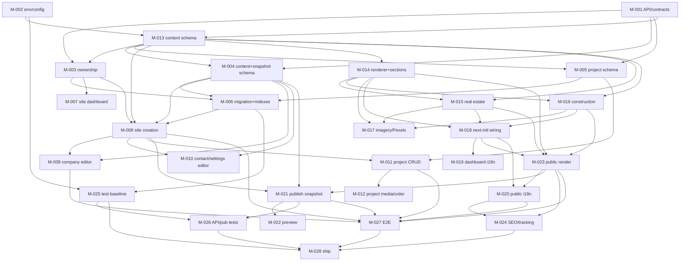

# Dependency Map

The milestone dependency graph, critical path, and parallelization guidance.
Source of truth for "what can I start now". Keep in sync with `ROADMAP.md` and
each milestone's own `Depends on` field.

## 1. Graph



Legend: `stab`=EPIC-001, `domain`=EPIC-002, `create`=EPIC-003, `edit`=EPIC-004,
`portfolio`=EPIC-005, `tpl`=EPIC-006, `i18n`=EPIC-007, `pub`=EPIC-008, `qa`=EPIC-009.

## 2. Dependency table

| ID | Prerequisites | Unblocks |
|---|---|---|
| M-001 | — | M-003, M-004, M-005, M-013 |
| M-002 | — | M-013, M-025 |
| M-013 | M-001, M-002 | M-003, M-004, M-005, M-008, M-014, M-015, M-016 |
| M-003 | M-001, M-013 | M-006, M-007, M-008 |
| M-004 | M-001, M-013 | M-006, M-008, M-009, M-010, M-021, M-023 |
| M-005 | M-001, M-013 | M-006, M-011 |
| M-006 | M-003, M-004, M-005 | M-008, M-025 |
| M-007 | M-003 | — |
| M-008 | M-003, M-004, M-006, M-013 | M-009, M-010, M-011, M-021, M-027 |
| M-009 | M-004, M-008 | M-027 |
| M-010 | M-004, M-008 | — |
| M-011 | M-005, M-008 | M-012, M-027 |
| M-012 | M-011 | — |
| M-014 | M-013 | M-015, M-016, M-017, M-018, M-023 |
| M-015 | M-013, M-014 | M-017, M-018, M-023 |
| M-016 | M-013, M-014 | M-017, M-018, M-023 |
| M-017 | M-013, M-014, M-015, M-016 | — |
| M-018 | M-014, M-015, M-016 | M-019, M-020, M-023 |
| M-019 | M-018 | — |
| M-020 | M-018, M-023 | M-024, M-027 |
| M-021 | M-004, M-008, M-023 | M-022, M-026, M-027 |
| M-022 | M-021 | — |
| M-023 | M-004, M-014, M-015, M-016, M-018 | M-020, M-021, M-024, M-027 |
| M-024 | M-020, M-023 | M-028 |
| M-025 | M-002, M-006 | M-026, M-028 |
| M-026 | M-025, M-021 | M-028 |
| M-027 | M-008, M-009, M-011, M-020, M-021, M-023 | M-028 |
| M-028 | M-024, M-025, M-026, M-027 | — |

## 3. Critical path

Longest chain gating the finish:

```
M-001 → M-013 → M-004 → M-006 → M-008 → M-009 → M-011 → M-014
      → M-015 → M-018 → M-023 → M-021 → M-027 → M-028
```

Any slip on these milestones slips the finish. Prefer to staff the critical path
first and parallelize the branches below around it.

## 4. Parallelization opportunities

After Phase A (`M-001`, `M-002`) and `M-013`:

- **Track 1 (domain):** M-003, M-004, M-005 can proceed in parallel; converge at
  M-006.
- **Track 2 (templates):** M-014 → {M-015, M-016} in parallel → M-017.
- **Track 3 (edit/portfolio):** after M-008, M-009/M-010 and M-011/M-012 are
  independent of the template track.
- **Track 4 (test infra):** M-025 tooling setup can begin right after M-002;
  domain tests need M-006.

Safe merge points (barriers): M-006, M-008, M-018, M-023, M-028.

## 5. Rules

- Do not start a milestone until **all** prerequisites are `Done` in
  `EXECUTION_STATUS.md`.
- If two milestones must land together, record the coupling here and in both
  files rather than starting early.
- Adding/removing a dependency requires updating this file, `ROADMAP.md`, the
  affected milestone files, and `EXECUTION_STATUS.md` in the same change.
- No cycles. The graph is a DAG; verify after any edit.
